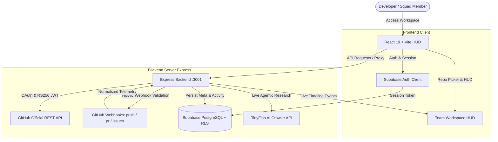

<div align="center">

# ⚡ HackForge OS
### *The Developer-Native Hackathon Operating Platform & Build Intelligence Engine*

[](https://vitejs.dev/)
[](https://react.dev/)
[](https://nodejs.org/)
[](https://supabase.com/)
[](https://docs.github.com/en/rest)
[](https://github.com/rachitbuild12/HackForge)

<br />

<p align="center">
  <b>HackForge</b> brings live GitHub development telemetry, Supabase authentication, TinyFish autonomous web research, gamified quest rewards, Build Intelligence provenance auditing, and cryptographic <b>Build Passports</b> into one coherent, developer-focused platform.
</p>

[Explore Live Platform](https://hackforges.netlify.app/) • [Run 5-Min Guided Demo](http://localhost:5173/demo) • [Report Issue](https://github.com/rachitbuild12/HackForge/issues)

</div>

---

## 🚀 Two Coherent Operational Modes

HackForge makes a crystal-clear distinction between live production functionality and seeded walkthrough scenarios:

| Mode | Purpose | Data Source | Visual Indicator |
|---|---|---|---|
| **Live Workspace** | Real hackathon squads building live | Real GitHub OAuth API, Supabase Auth, TinyFish live crawler | Honest empty states ("Not connected", "Awaiting telemetry") when data is missing |
| **Guided Demo Mode (`/demo`)** | 5-minute pre-mentor walkthrough across all 12 platform milestones | Deterministic scenario (`ETHGlobal Autonomous 2026`, squad `Nexus Sentinel`) | Visible, unobtrusive `[Simulated Data]` badge on all demo cards, timelines, and passports |

---

## ⚡ Core Capabilities

### 1. 🐙 Real GitHub Integration
* **Live Telemetry Stream:** Ingests authentic commits, active branch trees, pull request reviews, and issue discussions directly into HackForge's development timeline.
* **Server-to-Server Security:** Access tokens and RSA private keys are handled exclusively on the backend—**zero credentials or tokens ever touch the browser**.
* **HMAC Webhook Verification:** Verifies `X-Hub-Signature-256` payload signatures using cryptographic constant-time comparisons (`crypto.timingSafeEqual`) to prevent timing attacks.
* **Honest Empty States:** When no repository is connected, live dashboards clearly display "Not connected" and prompt repository linkage rather than inventing fake data.

### 2. ⚡ Supabase Identity & Persistence Layer
* **Universal Authentication:** Email/password registration, login sessions, and GitHub OAuth powered by Supabase Auth with automatic session refresh.
* **Granular Database Schema:** Tables for `github_app_installations`, `project_github_repositories`, and `project_github_activities` with Row-Level Security (RLS).
* **Resilient Architecture:** Automatic fallback to a secure server in-memory store when Supabase environment variables are omitted.

### 3. 🐟 TinyFish Autonomous Web Research Engine
* **Real-Time Technical Investigation:** Autonomous web agents crawl official technical documentation, API references, and open-source specifications via streaming Server-Sent Events (SSE).
* **Quest Synthesizer:** Converts complex research findings directly into executable milestone quests for hackathon squads.

### 4. 🛡️ Cryptographic Build Passports & Integrity Verification
* **Provenance Auditing:** Inspects commit cadence during the official hackathon window, flagging pre-existing code dumps and burst commits for organizer review ("Transparency, not automatic punishment").
* **SHA-256 Manifest Hash:** Computes authentic SHA-256 state digests using the Web Crypto API, creating a tamper-evident submission certificate with a public verification link.

### 5. 🎮 Milestone Quests & Live Organizer / Judge Decks
* **Gamified Progress Matrix:** Deconstructs hackathon tracks into sprint phases (Genesis, Core MVP, Deployment & Polish, Finale), awarding XP on verified deliverables.
* **Organizer Control Deck:** Live squad monitoring, whitelist management, and human-in-the-loop integrity clearance.
* **Jury Evaluation Queue:** Rubric scoring, draft persistence, and qualitative review without automated winner prediction bias.

---

## 🏗️ System Architecture



---

## 🛠️ Tech Stack

| Domain | Technology | Purpose |
|---|---|---|
| **Frontend** | React 19, Vite 6, React Router 7 | High-performance HUD, responsive glassmorphism UI |
| **Icons & Visuals** | Lucide React, Custom SVG Icons | Polished developer HUD visuals & cyber aesthetics |
| **Backend** | Express 5, Node.js 20+ | Secure token exchange, telemetry normalization, Webhook processing |
| **Authentication** | Supabase Auth + GitHub OAuth | Email/password auth, session persistence, OAuth callbacks |
| **Database** | Supabase (PostgreSQL) + In-Memory Fallback | Telemetry history, repository association, installations |
| **Security** | Node.js `crypto` (RS256, HMAC-SHA256) | Zero third-party crypto bloat, constant-time validation |
| **Web Research** | TinyFish Live Crawler API | Real-time web crawling & technical documentation synthesis |
| **Linting & Quality**| Oxlint, Node Test Suite | Sub-second AST linting and 100% automated test verification |

---

## ⚡ Quick Start

### 1. Clone the Repository
```bash
git clone https://github.com/rachitbuild12/HackForge.git
cd HackForge
```

### 2. Install Dependencies
```bash
npm install
```

### 3. Configure Environment Variables
Copy `.env.example` to `.env`:
```bash
cp .env.example .env
```

Populate the keys in `.env`:
```env
# Server & Client Origins
PORT=3001
CLIENT_URL=http://localhost:5173

# TinyFish API (for live web research)
TINYFISH_API_KEY=your_tinyfish_key_here

# Supabase Auth & Persistence
VITE_SUPABASE_URL=https://your-project.supabase.co
VITE_SUPABASE_ANON_KEY=your_supabase_anon_key
SUPABASE_URL=https://your-project.supabase.co
SUPABASE_ANON_KEY=your_supabase_anon_key

# GitHub Integration (Optional OAuth / App)
GITHUB_CLIENT_ID=
GITHUB_CLIENT_SECRET=
GITHUB_APP_ID=
GITHUB_APP_SLUG=
GITHUB_APP_PRIVATE_KEY=
GITHUB_WEBHOOK_SECRET=
```

### 4. Run Development Servers
Open two terminals or run concurrently:

**Terminal 1 — Backend Server:**
```bash
npm run server
```
*Backend runs on `http://localhost:3001`*

**Terminal 2 — Frontend Client:**
```bash
npm run dev
```
*Frontend runs on `http://localhost:5173`*

---

## 🧪 Real Test Runner (Zero Mocks)

HackForge includes a real integration test suite that tests live GitHub API connectivity against public repositories without mock data:

```bash
# Run real GitHub API and server integration tests
npm test
```

**Running Authenticated Suite with a Personal Token:**
```bash
node server/test-real-github.js ghp_your_token_here
```

**Running GitHub App Unit Suite (RS256 JWT, HMAC-SHA256, CSRF):**
```bash
npm run test:app
```

---

## 📁 Project Directory Structure

```
HackForge/
├── public/                 # Static assets, SVG icons, Netlify _redirects
├── server/                 # Express backend server & microservices
│   ├── server.js           # Server entry point, OAuth, routes, telemetry pipeline
│   ├── githubAppService.js # RS256 JWT, HMAC-SHA256 webhook validation, token cache
│   ├── githubAppRoutes.js  # GitHub App installation, CSRF validation, webhooks
│   ├── supabaseService.js  # Supabase REST client with automatic memory fallback
│   ├── supabase_schema.sql # Production PostgreSQL migration schema & RLS rules
│   ├── tinyfishRoutes.js   # Live web crawler & technical research endpoints
│   ├── test-real-github.js # Real network test runner against GitHub API
│   └── test-github-app.js  # Cryptographic JWT & webhook test suite
├── src/                    # React 19 Frontend application
│   ├── components/         # Reusable HUD elements, modals & navigation
│   │   ├── GitHubConnectModal.jsx  # Repository picker & GitHub auth modal
│   │   ├── Sidebar.jsx             # Universal navigation bar
│   │   └── TinyFishResearchModal.jsx # Live web investigation modal
│   ├── context/            # Global state (HackForgeContext.jsx)
│   ├── lib/                # Client libraries (supabaseClient.js)
│   ├── pages/              # Primary route views
│   │   ├── TeamWorkspace.jsx       # Main squad dashboard & telemetry feed
│   │   ├── Auth.jsx                # Supabase login & developer auth
│   │   ├── Dashboard.jsx           # Participant overview
│   │   ├── OrganizerControlCenter.jsx # Hackathon organizer monitoring
│   │   └── JudgeDashboard.jsx      # Scoring & Build Passport deck
│   └── utils/              # Build integrity, AI Copilot & scoring engines
├── package.json            # Scripts and dependencies
└── vite.config.js          # Vite configuration with /api backend proxy
```

---

## 🔒 Security Architecture

* **Least-Privilege Authorization:** Repository access requests are scoped strictly to `metadata:read`, `contents:read`, `pull_requests:read`, and `issues:read`.
* **Zero Secret Leakage:** Tokens and RSA private keys are stored securely in backend server memory and never dispatched to the client DOM or network responses.
* **Constant-Time HMAC Validation:** Every incoming webhook is checked against `X-Hub-Signature-256` using `crypto.timingSafeEqual` to eliminate timing side-channel attacks.
* **Row-Level Security (RLS):** All Supabase database tables enforce strict tenant separation policies.

---

## 📄 License

Distributed under the **MIT License**. See `LICENSE` for more information.

---

<div align="center">
  <sub>Engineered with precision for hackathon builders, organizers, and judges worldwide.</sub>
</div>
